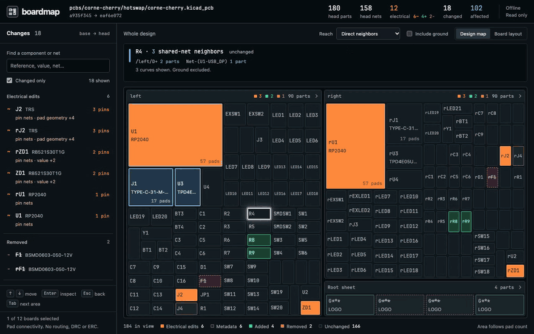
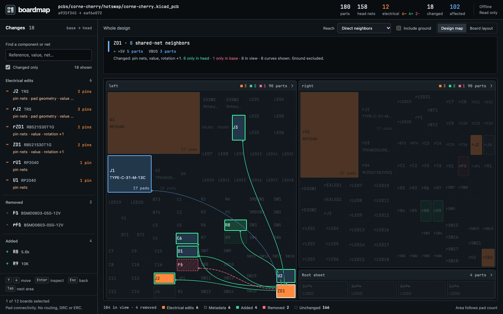
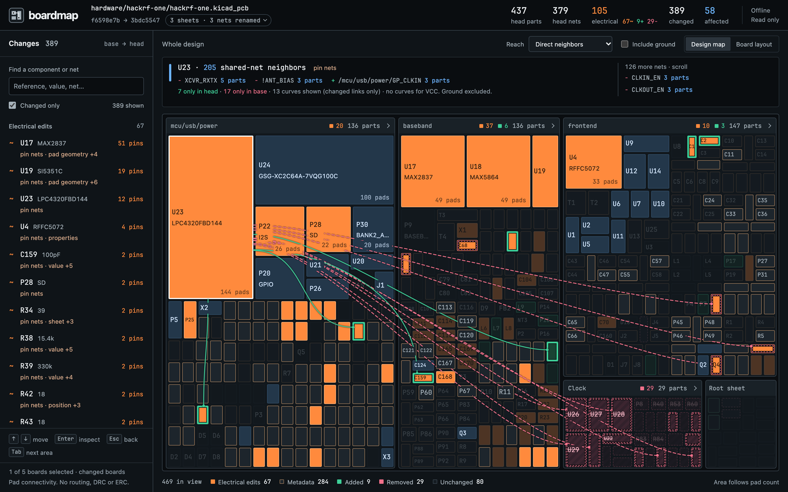

# boardmap

See what a PCB change touches.

A local, whole-design map for KiCad git reviews. Hover a part to trace its shared nets. Click it to inspect value, footprint, manufacturing fields, and pin-net changes, with before/after pad regions.



## Run it

Requires Node.js 22+ and Git. No KiCad installation, account, or runtime packages. Install from the main branch:

```sh
npm install -g github:krishhgg/boardmap#main && boardmap HEAD~1 HEAD
```

Run that in a KiCad git repository, then open the printed `http://127.0.0.1:<port>` URL. The server binds only to loopback, reads revisions through git objects, and leaves your checkout alone. It makes no network requests. Installation and fetching the demos need internet; reviewing an existing local repo works offline.

```sh
boardmap <base> <head>
boardmap main HEAD --board hardware/controller.kicad_pcb
boardmap v1 v2 --repo ../my-board --port 8080
boardmap main HEAD --json review.json
```

Both arguments must resolve to commits in the local repository. For PR-style review, pass the merge base as `<base>`. Boardmap compares exactly the two revisions you supply. Uncommitted work is outside the comparison.

By default, it includes every component in boards whose files changed. If no board changed, it includes all boards. The footer under the change list names the selection and shows its board count. Use `--board` with an exact repo-relative path to focus on one design. Added and deleted boards remain reviewable. `--json` exports the report without starting a server.

## Review the electrical impact

- The map groups parts by board and the schematic sheet names stored on footprints. Area follows numbered pad count, with a minimum size for small parts and sheet controls. Unchanged parts stay muted. Pin, pad, value, footprint, population and existing part-number replacements get solid orange; other modifications have neutral fill and a muted tan edge. Electrical additions are green and removals are striped pink. Metadata artwork keeps neutral fill and status outlines.
- Tab enters each component region once; arrows and Home / End move through it, and Enter / Space inspect. Hover or keyboard-focus any part, in the map or sidebar, to trace shared-net neighbors. Both revisions contribute connections, so disconnecting or removing a part still shows its former neighbors. Power nets connect a regulator to every part on that rail. Ground is excluded by name by default and can be included. A neighbor connected only in head gets a green ring and a green curve. A neighbor connected only in base gets a dashed pink ring and a dashed curve. Neighbors connected in both stay blue. In transitive mode, green and pink rings mark parts reachable in only one revision, blue covers the remaining structural reach, and only curves from the traced part carry revision color. The readout counts each kind and lists the nets the part joined or left first.
- On touch screens, tap once to preview reach, then tap the same part again or use its Open diff action to inspect. In the overview, tapping a part narrower than 24 pixels opens its sheet with that part previewed and scrolled into view. Drilled sheets fit complete references and have targets at least 32 pixels wide and tall. The changes list can be expanded above the map.
- Direct reach follows one net hop. Transitive reach walks through components and their nets. This is structural adjacency across both revisions, not circuit simulation or a claim that signals pass through an IC. Large transitive results can span most of a board. On a trace with more than 30 visible links, a net with more than 12 loads is treated as a rail: its loads keep a tint without a ring, and curves and rings go only to parts that also share a smaller net with the traced part. The readout names those rails. In direct reach, a part with more than 60 neighbors, or more than 20 curves to draw, is traced as a hub: when any of its connections changed, curves are drawn for the changed connections only, and neighbors whose connection did not change keep a tint without a ring. Above 80 remaining links, curves show only changed connections and links involving electrical, added or removed neighbors. Curves fade under part names and pass behind sheet headers, and each one starts at a dot inside the traced part. Every reachable neighbor stays highlighted. The desktop readout names what changed on the traced part beside its reference, ranks joined and left signal nets first, then joined and left rails, then the rest by neighbor count, and scrolls the remaining nets separately from its counts. Its idle and traced states share one height, so a hover does not move the map. Pause over another part to change the source. Movement across intervening tiles preserves the trace while you reach its net list. On phones, the readout shows the leading nets and stays visible while a drilled sheet scrolls. In the part inspector, open the neighbors disclosure to read every reached reference grouped by net, including parts outside the current sheet. Each reference opens its own inspection. Counts overlap when parts share several nets.
- Click a sheet to zoom, use breadcrumbs to return, or switch to Board layout, which draws an approximate outline of each footprint from its pad positions and sizes inside a bounding frame and names changed parts. A name sits nearest its own marker, or moves out of a crowded cluster on a thin line to its marker. A drilled sheet grows only as needed to fit its references. Desktop sheets scroll inside the map; phone sheets use document scrolling. Each populated board has its own chooser when a repository contains multiple designs.
- Click a part for its semantic diff and local pad regions. Press Escape or Back to map to return. With no part traced, Escape steps out of a drilled sheet. The returned component stays marked and named in the reach readout for mouse, keyboard and touch. Search by reference, value, footprint, or net. The sidebar follows the current board or sheet. Electrical edits come first, sorted by rewired-pin count and then natural reference order, followed by Removed, Added and Metadata groups. Zero-pad artwork stays in Metadata with its original added or removed status. Pin rows lead the inspector; changed property keys have individual rows, and changed pad geometry is available in a disclosure. The Changed only filter does not hide unchanged context in the map.

The header counts head parts and nets, electrical changes and all changed components including removals. Beside the electrical total it shows the three terms of that sum: electrical edits, added parts and removed parts. Sheet headers and the legend use the same three classes and colors. Electrical changes include parts with pin, pad, value or footprint edits, DNP population transitions, replacements of both-present MPN / Part Number / Manufacturer Part Number identifiers, and added or removed parts with pads, except explicitly flagged unconnected fiducials. A bounded legacy DNP-field migration on verified board features stays in Metadata; BOM exclusion never defines population state. See [assembly priority](https://github.com/krishhgg/boardmap/blob/edba803fab67f7832c6dbb8039c47678788ae0a6/docs/assembly-priority.md). Filling an empty supplier or descriptive field alone stays in Metadata. The in-view total includes removed components, and its tooltip gives their count. Affected means unchanged direct neighbors of changed parts, excluding ground, across either revision. It is independent of the current hover and reach controls. Stable sheet UUIDs identify label renames. Boardmap reports these separately and normalizes old hierarchical net prefixes only when the mapping is unambiguous and does not merge distinct historical nets. Standalone net-label changes are reported separately when a unique, complete set of component pins matches across revisions. Added and removed loads participate in that proof; ambiguous matches and changed connections stay in the pin diff. Footprint rotations compare pad angles relative to the footprint, so rotation alone does not create a pad dump.





## Try the real PRs

Clone the repository to use the demo scripts:

```sh
git clone https://github.com/krishhgg/boardmap.git
cd boardmap
node scripts/demo.mjs corne
node scripts/demo.mjs hackrf
```

Each command fetches two pinned commits into a per-user cache, without a checkout, then starts the local UI. Stop one review with Ctrl+C before running the next. The cache is under your home directory in `.cache/boardmap/demos` and can be deleted after use. Only the first fetch requires internet if you keep the git objects and run the CLI directly.

| Source PR                                                                             | Comparison                          | Head parts | Electrical | Changed | Unchanged affected |
| ------------------------------------------------------------------------------------- | ----------------------------------- | ---------: | ---------: | ------: | -----------------: |
| [HackRF #1411, HackRF One r10](https://github.com/greatscottgadgets/hackrf/pull/1411) | `f6598e7b..3bdc5547`, changed board |        437 |        105 |     389 |                 58 |
| [Corne #237, v4.1.0](https://github.com/foostan/crkbd/pull/237)                       | `a935f345..eaf6e072`, cherry board  |        180 |         12 |      18 |                102 |

The Corne PR changes both cherry and chocolate boards. Without `--board`, its report includes 360 head parts and 30 changed parts. The demo script selects cherry for a smaller review. See [current net-label proof](https://github.com/krishhgg/boardmap/tree/edba803fab67f7832c6dbb8039c47678788ae0a6/docs/media/net-labels), [visible return and readable-sheet captures](https://github.com/krishhgg/boardmap/tree/edba803fab67f7832c6dbb8039c47678788ae0a6/docs/media/continuity) the [instrument demo](https://github.com/krishhgg/boardmap/tree/edba803fab67f7832c6dbb8039c47678788ae0a6/docs/media/instrument) and the [current UI gallery](https://github.com/krishhgg/boardmap/tree/156f3c681341db3fb0346fc2e72f152d9122de5b/docs/media/ui). The older galleries record earlier revisions of the interface. Captures are actual Chromium runs, not mockups.

## Where it fits

| Tool                                                          | Review focus                                                                                            |
| ------------------------------------------------------------- | ------------------------------------------------------------------------------------------------------- |
| boardmap                                                      | Local whole-design map and shared-net impact, including removed connections and opt-in transitive reach |
| [KiRI](https://github.com/leoheck/kiri)                       | Visual comparison of KiCad schematic and PCB revisions                                                  |
| [KiCAD-Prism](https://github.com/krishna-swaroop/KiCAD-Prism) | Self-hosted collaboration, project viewing, and component governance                                    |
| [KiCad Viewer](https://www.kicadviewer.com/pull-requests)     | Visual and semantic PR diffs in its viewer                                                              |

Use boardmap to answer "what else shares these nets?" before inspecting layout detail in KiCad or another visual diff tool.

## Scope and limits

This version reads `.kicad_pcb` footprint and pad data, including the s-expression forms used in KiCad 7–10 and older `module` boards. The checked-in real fixtures cover older HackRF, Corne, and an official KiCad 10 QA board with name-only nets. Official KiCad 7, 8 and 9 demo boards were also parsed during validation. It does not claim full coverage of every KiCad format field.

- Connectivity comes from board pad net assignments. A schematic-only change, including a value or net change not yet pushed to the PCB, is not analyzed. Schematic hierarchy comes from footprint sheet metadata; absent metadata falls into Root sheet. Full hierarchical schematic parsing is future work.
- The diff compares values, footprint names, fields such as MPN, position, rotation, side, sheet, numbered pin-net assignments, and stored pad geometry, drills, and layers. Copper tracks, vias, zones, graphics, design rules and other manufacturing settings are outside this comparison. A copper-only edit can report zero changed components.
- The local regions draw basic pad shapes, drill holes and neighboring footprints, not full silkscreen or copper artwork. Nonstandard shapes are labeled approximate. The board view draws approximate footprint outlines from pad positions and sizes, without custom pad polygons. It enlarges the smallest parts so they stay selectable, nudges enlarged electrical changes apart by at most 18 pixels where they would overlap, lets a touch that lands on no changed part pick the nearest of them within 22 pixels, lists the changes within 30 pixels of a tap as full-size buttons under the board on touch screens, and does not draw the board edge or copper. Densely packed parts can overlap. Use the map or sidebar to select those parts.
- Components match by board path and reference, with UUIDs for duplicate references. Reference renames or moving parts between board files appear as removal/addition. Net names are scoped per board. Ground suppression recognizes common names such as GND, AGND, DGND, GNDR, GNDL, VSS and their sheet-qualified variants; other return names remain included. This is a name-based filter.
- DRC/ERC delta and a GitHub Action that posts a PR summary are future work. There is no release or npm registry publication.

## Development

```sh
npm ci
npm test
npx playwright install chromium
npm run test:e2e -- --base HEAD --head HEAD
npm run test:e2e -- --fixture
npm run test:e2e -- --fixture --removed
```

Unit tests run without installing any dependencies. Playwright is a development dependency only. For an existing Chromium binary, set `BOARDMAP_BROWSER` to its executable path instead of downloading a browser.

To reproduce real-data captures after fetching the demos:

```sh
node scripts/demo.mjs hackrf --json /tmp/hackrf-review.json
npm run test:e2e -- --repo "$HOME/.cache/boardmap/demos/hackrf" \
  --base f6598e7b14b7ec539126479e9c6d095c668a534e \
  --head 3bdc5547004c8244de5f37104410c363854e5634 --out docs/media/instrument/hackrf
```

The demo command prints its cache path. The synthetic `--fixture` browser run creates a private temporary git repository with two commits, nine boards, and modified, added and removed components, then deletes it. It also checks focus after resizing a diff, clipping of diagonal pads, changed-only pad colors, and the changed drill geometry disclosure. The e2e test starts an ephemeral loopback server, checks the map, reach modes, ground toggle, diff, drill-in, breadcrumbs, search, every board chooser, and mobile overflow, then closes it. `--out` writes 1440×900 and 1280×800 captures plus 390×844 touch states. The browser checks the actual rendered mono font through CDP, complete reference labels, sidebar priority and counts, full neighbor highlights, and touch preview before inspection. Run `node scripts/capture-demo.mjs PATH_TO_CORNE_CACHE --gif` to refresh the eight-second ZD1 GIF with FFmpeg. Run `node scripts/capture-ui.mjs hackrf PATH_TO_HACKRF_CACHE OUT_DIR` to capture the label panel, inspector, map and phone states, plus a short recording of drill-in and reach.

The bundled JetBrains Mono font uses the SIL Open Font License; its notice is in [assets/fonts/OFL.txt](assets/fonts/OFL.txt). Fonts and the shared header/favicon mark are served by fixed local asset routes. Screenshots and the GIF are excluded from the installed package.

MIT license for boardmap. Real-world test boards and their notices have separate licenses under [test/fixtures](test/fixtures/README.md). Demo screenshots contain design data from those upstream projects.
