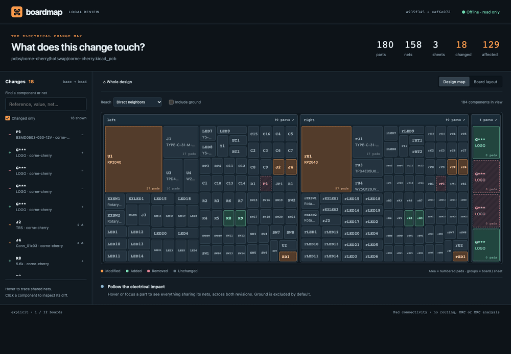
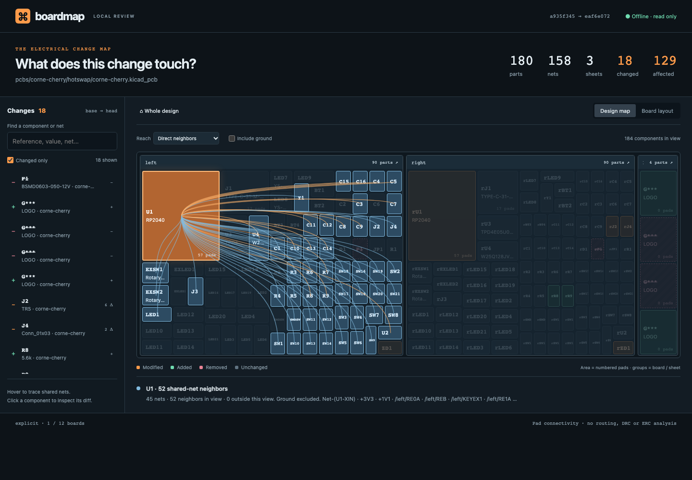

# boardmap

See what a PCB change touches.

A local, whole-design map for KiCad git reviews. Hover a part to trace its shared nets. Click it to inspect value, footprint, manufacturing fields, and pin-net changes, with before/after pad regions.



## Run it

Requires Node.js 22+ and Git. No KiCad installation, account, or runtime packages. Until the PR stack merges, install from the implementation branch:

```sh
npm install -g github:krishhgg/boardmap#feat/review-guide && boardmap HEAD~1 HEAD
```

Run that in a KiCad git repository, then open the printed `http://127.0.0.1:<port>` URL. The server binds only to loopback, reads revisions through git objects, and leaves your checkout alone. It makes no network requests. Installation and fetching the demos need internet; reviewing an existing local repo works offline.

```sh
boardmap <base> <head>
boardmap main HEAD --board hardware/controller.kicad_pcb
boardmap v1 v2 --repo ../my-board --port 8080
boardmap main HEAD --json review.json
```

Both arguments must resolve to commits in the local repository. For PR-style review, pass the merge base as `<base>`. Boardmap compares exactly the two revisions you supply. Uncommitted work is outside the comparison.

By default, it includes every component in boards whose files changed. If no board changed, it includes all boards. The footer names the selection and shows its board count. Use `--board` with an exact repo-relative path to focus on one design. Added and deleted boards remain reviewable. `--json` exports the report without starting a server.

## Review the electrical impact

- The map groups parts by board and the schematic sheet names stored on footprints. Area follows numbered pad count, with a minimum size for small parts and sheet controls. Unchanged parts stay muted; modified parts are orange; additions are green; removals are striped pink.
- Hover or keyboard-focus any part, in the map or sidebar, to trace shared-net neighbors. Both revisions contribute connections, so disconnecting or removing a part still shows its former neighbors. Power nets connect a regulator to every part on that rail. Ground is excluded by name by default and can be included.
- Direct reach follows one net hop. Transitive reach walks through components and their nets. This is structural adjacency across both revisions, not circuit simulation or a claim that signals pass through an IC. Large transitive results can span most of a board.
- Click a sheet to zoom, use breadcrumbs to return, or switch to component centers in Board layout. Each board has its own chooser when a repository contains multiple designs.
- Click a part for its semantic diff and local pad regions. Press Escape or Back to map to return. Search by reference, value, footprint, or net. The sidebar's Changed only filter does not hide unchanged context in the map.

The stats count head parts and nets, sheet groups across both revisions, and changed components including removals. Affected means unchanged direct neighbors of changed parts, excluding ground, across either revision. It is independent of the current hover and reach controls. HackRF's large metadata migration changes nearly every component, so its affected count is zero; hover still exposes all neighbors.



## Try the real PRs

Clone this branch to use the demo scripts:

```sh
git clone --branch feat/review-guide https://github.com/krishhgg/boardmap.git
cd boardmap
node scripts/demo.mjs corne
node scripts/demo.mjs hackrf
```

Each command fetches two pinned commits into a per-user cache, without a checkout, then starts the local UI. Stop one review with Ctrl+C before running the next. The cache is under your home directory in `.cache/boardmap/demos` and can be deleted after use. Only the first fetch requires internet if you keep the git objects and run the CLI directly.

| Source PR | Comparison | Head parts | Changed | Unchanged affected |
| --- | --- | ---: | ---: | ---: |
| [HackRF #1411, HackRF One r10](https://github.com/greatscottgadgets/hackrf/pull/1411) | `f6598e7b..3bdc5547`, changed board | 437 | 452 | 0 |
| [Corne #237, v4.1.0](https://github.com/foostan/crkbd/pull/237) | `a935f345..eaf6e072`, cherry board | 180 | 18 | 129 |

The Corne PR changes both cherry and chocolate boards. Without `--board`, its report includes 360 head parts and 30 changed parts. The demo script selects cherry for a smaller review. See [all captures](docs/media), including HackRF and mobile layouts. Captures are actual Chromium runs, not mockups.

## Where it fits

| Tool | Review focus |
| --- | --- |
| boardmap | Local whole-design map and shared-net impact, including removed connections and opt-in transitive reach |
| [KiRI](https://github.com/leoheck/kiri) | Visual comparison of KiCad schematic and PCB revisions |
| [KiCAD-Prism](https://github.com/krishna-swaroop/KiCAD-Prism) | Self-hosted collaboration, project viewing, and component governance |
| [KiCad Viewer](https://www.kicadviewer.com/pull-requests) | Visual and semantic PR diffs in its viewer |

Use boardmap to answer "what else shares these nets?" before inspecting layout detail in KiCad or another visual diff tool.

## Scope and limits

This version reads `.kicad_pcb` footprint and pad data, including the s-expression forms used in KiCad 7–10 and older `module` boards. The checked-in real fixtures cover older HackRF and modern Corne boards. It does not claim full coverage of every KiCad format field.

- Connectivity comes from board pad net assignments. A schematic-only change, including a value or net change not yet pushed to the PCB, is not analyzed. Schematic hierarchy comes from footprint sheet metadata; absent metadata falls into Root sheet. Full hierarchical schematic parsing is future work.
- The diff compares values, footprint names, fields such as MPN, position, rotation, side, sheet, numbered pin-net assignments, and stored pad geometry, drills, and layers. Copper tracks, vias, zones, graphics, design rules and other manufacturing settings are outside this comparison. A copper-only edit can report zero changed components.
- The local regions draw pads and neighboring footprints, not full silkscreen or copper artwork. The board view shows footprint centers and can overlap densely packed parts. Use the map or sidebar to select those parts.
- Components match by board path and reference, with UUIDs for duplicate references. Reference renames or moving parts between board files appear as removal/addition. Net names are scoped per board. Ground suppression recognizes common names such as GND, AGND, DGND and their sheet-qualified variants; other return names require the ground toggle or will be included.
- DRC/ERC delta and a GitHub Action that posts a PR summary are future work. There is no release or npm registry publication.

## Development

```sh
npm ci
npm test
npx playwright install chromium
npm run test:e2e -- --base HEAD --head HEAD
npm run test:e2e -- --fixture
```

Unit tests run without installing any dependencies. Playwright is a development dependency only. For an existing Chromium binary, set `BOARDMAP_BROWSER` to its executable path instead of downloading a browser.

To reproduce real-data captures after fetching the demos:

```sh
node scripts/demo.mjs hackrf --json /tmp/hackrf-review.json
npm run test:e2e -- --repo "$HOME/.cache/boardmap/demos/hackrf" \
  --base f6598e7b14b7ec539126479e9c6d095c668a534e \
  --head 3bdc5547004c8244de5f37104410c363854e5634 --out docs/media/hackrf
```

The demo command prints its cache path. The synthetic `--fixture` browser run creates a private temporary git repository with two commits, nine boards, and modified, added and removed components, then deletes it. It also checks focus after resizing a diff and clipping of diagonal pads. The e2e test starts an ephemeral loopback server, checks the map, reach modes, ground toggle, diff, drill-in, breadcrumbs, search, every board chooser, and mobile overflow, then closes it. `--out` writes screenshots.

MIT license for boardmap. Unmodified real-world test boards and their notices have separate licenses under [test/fixtures](test/fixtures/README.md). Demo screenshots contain design data from those upstream projects.
